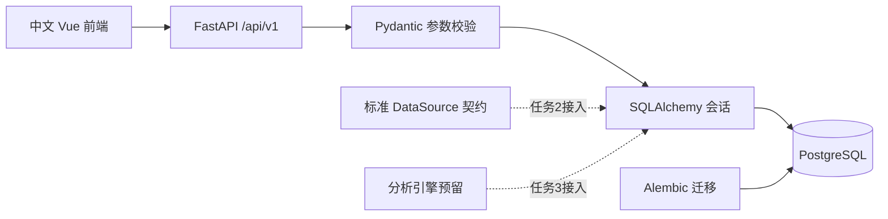
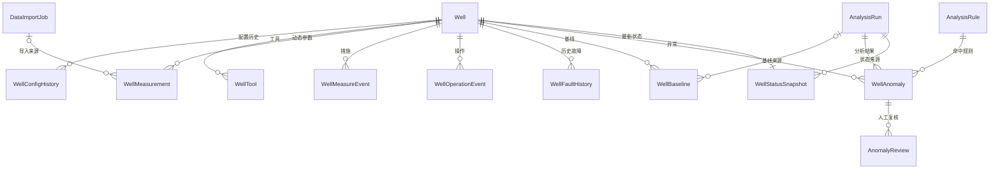
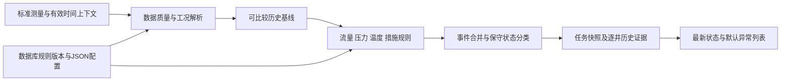

# 架构与数据口径（任务1至3）

前端 Vue 3 + TypeScript + Element Plus，预装 ECharts。前端通过 `/api/v1` 访问 FastAPI，基础 CRUD 经过 Pydantic 校验、SQLAlchemy 会话与 PostgreSQL 约束。Pandas、NumPy、OpenPyXL 已列为依赖，任务2接入。数据库迁移是唯一建表入口，应用不调用 `create_all()`。

## 数据关系

所有实体采用 UUID 主键，UUID由应用生成。井号有唯一约束，允许修改，不影响历史记录。外键采用 RESTRICT，防止删除上游实体导致证据丢失；基础 DELETE 对有关联的记录返回409。

所有事件时间接收带时区 ISO 8601，入口转为UTC，PostgreSQL存储为 timestamptz。配置、工具、措施、操作、历史故障使用半开时间区间 `[effective_start, effective_end)`；结束为空代表持续有效，有结束时必须晚于开始。不同措施和工具可同时有效。当前只校验单条区间，配置区间冲突的业务处理留给任务2/3工况解析，不将重叠配置自动解释为正常。

测量唯一键是 `(well_id, measured_at)`，同一时刻不同来源也不能插入第二条记录。这是任务2幂等导入的存储基础；任务1重复写入返回409，导入去重计数和错误行报告尚未实现。数值允许空，避免把缺失值变成零；质量标记独立。暂不在测量存储层拒绝负值，任务2/3将保留原始异常值并记录质量问题。浮点 NaN/Infinity 在 API 入口拒绝。

规则按 `(code, version)` 唯一。任务执行保存规则快照和数据截止时间；异常保存规则快照和证据。异常在单次任务内按指纹唯一，允许不同任务保存各自分析结果。最新状态按 well_id 唯一；没有充分依据时默认“数据待核实 / 工况待核实”。任务1没有分析执行接口，CRUD修改规则不会自动运行尚未实现的引擎。

生产数据库与生产数据源是不同概念：PostgreSQL是本系统持久化存储；`DatabaseDataSource` 是未来外部生产库的接入契约，当前只接受内存测试记录，不会建立外部连接。Excel与Mock适配器在任务2实现。

## 参数单位

| 字段 | 中文 | 标准单位 |
|---|---|---|
| tubing_pressure_mpa | 油压 | MPa |
| casing_pressure_mpa | 套压 | MPa |
| back_pressure_mpa | 井口回压 | MPa |
| instantaneous_flow_m3_h | 瞬时流量 | m³/h |
| cumulative_flow_m3 | 累计流量 | m³ |
| gas_temperature_c | 气流温度 | ℃ |
| liquid_rate_m3_d | 产液量（第七项暂定） | m³/d |

标准体积的标况口径、压力为表压还是绝压、现场时区及累计量复位语义，任务2接入前需要记录在映射和来源元数据中。当前没有单位换算或工艺判断。

## 当前限制

基础 CRUD 供本地开发；没有身份认证、批量导入、分析调度或真实数据库连接。大批量测量插入与导入原子性在任务2处理。请求分页最大500条，井号搜索转义通配符，支持工区与 well_id 过滤。接口不暴露 SQL、数据库地址或内部异常信息。历史与分析结果当前可通过基础 CRUD 修改；任务3需在业务接口收紧版本与证据的不可变策略。

## 任务2实现状态（2026-10-22）

ExcelDataSource与MockDataSource已实现，导入服务位于 `app/services/imports.py`，演示导出与装载位于 `app/services/demo.py`。DataImportJob已有字段足够保存预览、确认映射、单位、时区、计数与错误；测量已有import_job_id和唯一键，因此任务2无需新增表/列，继续使用0001_initial迁移。

前端 `/import` 已接入上传预览、映射确认、单位选择、入库结果、报告下载和600井生成。其他页面仍占位。具体接口、场景与边界以 `TASK2_GUIDE.md` 为准，前文任务1状态段落保留为历史设计。

## 任务3实现状态（2026-10-22）

前文任务1/2的限制保留为历史记录；当前Excel、Mock与分析引擎已接入，默认演示规模1000井。前端新增运行分析和规则配置，任务4的完整业务页仍未实现。

执行依赖REPEATABLE READ连接，一次性查询范围内测量与事件，按UUID分组，逐井分析后批量持久化。生产配置只消费已定义cycle字段，工具、措施等上下文不读模拟标签；生成器场景预期只供测试脚本使用。历史基线只使用决策时刻之前、相同当前配置/工具且排除措施/停井/故障的样本；演示趋势使用对数拟合与可配置R²阈值。

新实体WellAnalysisResult保留每次任务逐井结论（包括正常井），WellStatusSnapshot保留最新数据窗口结果。分析任务和异常均保存规则快照、输入摘要、关键代表采样与事件关联。不是原始数据库的完整备份；后续如需重放被修改的全部源数据，应增加来源不可变存档策略。

失败回滚整批结果，另存失败任务。当前同步执行，数据库事务锁拒绝并发分析；没有后台队列、认证、实时采集或生产调度。默认演示配置必须经过现场标定后才能用于真实生产判断。
